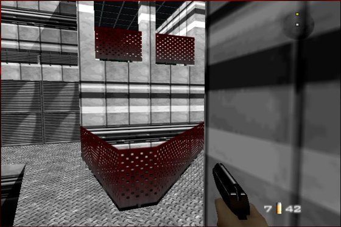

# GoldenEye 007 for Original Xbox and Windows

Play the solo campaign, share a couch for split-screen, or go head-to-head with an original Xbox and a Windows PC. On the same LAN, either machine can host. The other player picks the match from a list and joins.

*Complex over LAN. The original Xbox is hosting, and a Windows player has joined.*

| Solo Campaign · Dam | Local Multiplayer · Complex |
| --- | --- |
|  |  |
| Xbox build running in xemu | Four players on one original Xbox |

## Play on original Xbox

1. Supply your own retail US (NTSC-U) GoldenEye 007 ROM. Set up nxdk and its tools, then run `python3 port/xbox/build.py --rom data/ge007.ntsc-final.z64` from the repository root in the activated SDK shell. [Xbox build prerequisites](DOWNSTREAM.md#build-and-boot)
2. Copy the three files from `build-xbox/disc/` into one game folder on your Xbox: `default.xbe`, `xbox.bin`, and `ge007.ntsc-final.z64`.
3. Launch `default.xbe` from your Xbox dashboard and select a dossier.

**Using xemu?** Load the locally built `build-xbox/ge007.iso` as the DVD in a 64 MiB Xbox profile and reset.

## Play on Windows

1. Prepare your retail US ROM and extract the game assets. The build guide covers the required tools and native model and stage data. [Windows build and asset instructions](docs/building.md)
2. From the repository root in an MSYS2 MINGW64 shell, run `./build-pc.sh ntsc-final`.
3. Launch `./build-pc/ge007.x86_64.exe` from the repository root. Select a dossier to open the game mode menu.

## Choose a game mode

| Windows and Xbox dossier option | How to play | Tested |
| --- | --- | --- |
| **Solo Campaign** | Pick a mission and difficulty, read the briefing, and enter the field. | Dam reached gameplay through the dossier in xemu. Full campaign progression on original hardware is unverified. |
| **LAN Multiplayer** | Use matching builds on the same LAN. Pick **Host Match** on either machine. On the other, pick **Join Match** and select the host. **Enter IP manually** is also available. | Original Xbox and Windows have each hosted a two-player match in Complex. [Host discovery](https://github.com/ZacharyLeahan/goldeneye-nxdk/issues/23) · [Xbox hosting](https://github.com/ZacharyLeahan/goldeneye-nxdk/issues/24) |
| **Local Multiplayer** | Connect controllers, choose an arena and rules in Multiplayer Options, then press Start. | Two-player firefights and four-player split-screen have run on original Xbox. All eleven arenas support four players on Xbox. |

**Facility with a Simulant (prototype).** Connect two controllers, highlight **Local Multiplayer**, and press **D-pad right** to start Facility with one computer opponent. Both players keep their own half of the screen. Press **A** on the same row for the regular couch setup.

## Where GE32 fits

This fork focuses on original Xbox couch play with modern controls. The Windows build offers the same three modes and can play a private LAN match with a matching Xbox build. Both games use the upstream PC port's dossier and this fork's LAN code. GE32 public lobbies run on a separate multiplayer system.

Our equipment wheel, precision aim, slide, mantle and jump-pad work began in a Windows extension for Popnoodler's GE32. Windows and Xbox compile their movement and equipment directly from `port/controls/`. You can build and play either version without a GE32 installation or the optional extension. On Windows, launch `ge007.x86_64.exe` for this fork's campaign, split-screen or LAN. Jump pads are available from the equipment wheel, including in couch play.

The optional GE32 extension runs in a separate installation of `GE32.exe` and loads `weapon-wheel.dll`. Its dossier offers **Coop Campaign**, **Online Multiplayer** and **Local Multiplayer**. The extension is available for players who want to try that version independently. [GE32 release](https://popnoodler.itch.io/ge32) · [Extension setup and controls](mods/the-finals/README.md)

## Modern movement and equipment

The controls take inspiration from modern shooters like *THE FINALS*. Sprint into a slide, mantle a ledge, or use the equipment wheel to throw a grenade or deploy a jump pad.

| Action | Controller input |
| --- | --- |
| Jump and mantle | Press **A** to jump. Move toward a ledge and press **A** near the lip to climb it. |
| Crouch and slide | Tap **B** to crouch. Tap **B** while sprinting at speed to slide. Press **A** to jump out of the slide. |
| Quick slap | Click the **right stick** on Windows or Xbox to strike with Bond’s palm and return to your equipped weapon. |
| Sprint | Click the **left stick** while moving forward. |
| Aim and fire | Look with the **right stick**, hold **LT** for fine aim and pull **RT** to fire. **X** reloads and **Y** interacts. |
| Equipment wheel | Hold **LB** on Windows or **White** on Xbox. Point the right stick and release to equip. Right selects grenades, down selects the jump pad, and the other slots hold owned guns. Each player controls their own wheel. |
| Deploy a jump pad | Equip the pad, aim at a valid floor surface and pull **RT**. Either player can use the placed pad. |

In Xbox multiplayer, damaging an opponent reveals their health above them, with a blue row for armor. Another hit refreshes the meter. It holds for 3.25 seconds and fades over 0.20 seconds.

## Performance on original Xbox

| Workload | Displayed FPS |
| --- | ---: |
| Egypt over LAN, one full-screen view on the Xbox at 480p | **59.13** |
| Egypt in two-player split-screen, both players turning, firing, and throwing grenades | **46.29** |

These figures count distinct frames displayed on the physical Xbox during each test. [LAN performance details](https://github.com/ZacharyLeahan/goldeneye-nxdk/issues/21#issuecomment-7015760434) · [Split-screen performance details](https://github.com/ZacharyLeahan/goldeneye-nxdk/issues/21#issuecomment-7016289480)

## Performance on Windows and original Xbox

**Original Xbox split-screen falls short of sustained 60 FPS during close-range grenade combat.** Each average below gives equal weight to all 11 arenas, using one 12-second replay per arena and player count. FPS counts distinct frames displayed on the console.

| Local players | Average displayed FPS | Range across arenas |
| --- | ---: | ---: |
| 2 | 48.8 | 42.9–50.7 |
| 3 | 38.3 | 27.8–45.1 |
| 4 | 22.3 | 18.7–25.7 |

Four-player combat was slowest on Egypt and fastest on Stack. Across the 11 four-player runs, the 95th-percentile frame interval ranged from 66.7 to 83.3 ms. A steady 60 FPS would display a new frame every 16.7 ms. [Per-arena results and test conditions](DOWNSTREAM.md#local-multiplayer-release-measurements)

| Platform and workload | Measured frame rate |
| --- | --- |
| Windows, fixed Egypt camera, two game processes on one PC | **60.00 FPS host / 59.99 FPS guest**. Each rate uses the time between 1,437 consecutive render completions over about 24 seconds. |
| Original Xbox, same Egypt LAN firefight, 480p | **50.00 → 59.13 displayed FPS** with the scheduler fix. Observed repeated refreshes fell from **113 to 8**. The 95th-percentile display interval fell from 33.33 to 16.67 ms. |
| Original Xbox, heavy two-player Egypt split-screen | **46.29 displayed FPS** across 925 comparable camera steps with the regular vertex writer. Both players turned, fired and threw grenades. |
| Original Xbox, four-player local combat on all 11 arenas | **34.07 completed FPS** over 322.79 seconds. The slowest arena was Caverns at 24.5 FPS overall and 17.0 FPS during the grenade window. [Per-arena frame times](DOWNSTREAM.md#four-player-frame-times-on-original-xbox) |

Completed FPS counts render completions. Displayed FPS counts distinct frames seen at physical Xbox refreshes. The LAN guest draws one full-screen view. Local split-screen draws each active player's view. To see displayed FPS and recent frame times during play, place an empty `ge-perf-hud.on` file beside the Xbox executable and relaunch. [Performance overlay](DOWNSTREAM.md#performance-overlay) · [Windows replay and measurement instructions](DOWNSTREAM.md) · [Xbox LAN measurements](https://github.com/ZacharyLeahan/goldeneye-nxdk/issues/21#issuecomment-7015760434) · [Xbox split-screen measurements](https://github.com/ZacharyLeahan/goldeneye-nxdk/issues/21#issuecomment-7016289480)

The largest LAN gain came from starting graphics work sooner. When an audio task and a graphics task arrived together, the earlier scheduler left both queued until the next refresh. Accepting the pair immediately and preserving audio priority cut average submission-to-handoff time from **4.05 to 0.66 ms**. The renderer also skips drawing the hidden LAN seat while continuing its gameplay updates. Reusing material setup across vertex loads saved another **0.14–0.18 ms per frame** in two separate hardware trials. [Scheduler trace](https://github.com/ZacharyLeahan/goldeneye-nxdk/issues/21#issuecomment-7015760434) · [Material reuse trials](https://github.com/ZacharyLeahan/goldeneye-nxdk/issues/21#issuecomment-7014737918)

Caching the equipment-wheel artwork helped local multiplayer most when both players opened it. The fixed Complex scene went from **7.5 to 60.0 FPS**. A separate experimental LAN renderer reached **59.92 displayed FPS** in Egypt, with zero observed repeats and one gap in refresh sampling. The playable build uses the scheduler fix. [Equipment-wheel measurements](DOWNSTREAM.md#original-xbox) · [Experimental renderer A/B](https://github.com/ZacharyLeahan/goldeneye-nxdk/issues/21#issuecomment-7016408401)

A physical Xbox joined a Windows host and fired on all eleven retail multiplayer arenas. Current goals include frame pacing, local match setup and finding hosts on the LAN. Xbox hosting is deferred. [LAN testing](https://github.com/ZacharyLeahan/goldeneye-nxdk/issues/19) · [Local multiplayer goals](https://github.com/ZacharyLeahan/goldeneye-nxdk/issues/22) · [Host discovery](https://github.com/ZacharyLeahan/goldeneye-nxdk/issues/23) · [Future Xbox hosting](https://github.com/ZacharyLeahan/goldeneye-nxdk/issues/24)

## Upstream and credits

- The reconstructed game comes from the GoldenEye 007 decompilation by Larry Ficken (kholdfuzion) and contributors. The native PC port supplies the desktop runtime, controls, menus and split-screen support that this fork builds on. [GoldenEye decompilation](https://github.com/n64decomp/007) · [GoldenEye PC port](https://github.com/jkdansereau/goldeneye-pc-port)
- The XboxDev community’s nxdk supplies the original Xbox toolchain, runtime and pbkit graphics library. The Xbox NV2A renderer and presentation fixes were adapted from Perfect Dark X. The Perfect Dark PC port by Ryan Dwyer and contributors provided the software Fast3D renderer lineage and a reference for porting Rare’s engine. [nxdk](https://github.com/XboxDev/nxdk) · [Perfect Dark X](https://github.com/GTTeancum/Perfect-Dark-X) · [Perfect Dark PC port](https://github.com/perfect-dark-pc-port/perfect_dark) · [Third-party notices](NOTICE)
- The Neverball nxdk port provided a comparison for Xbox push-buffer sizing and VBlank presentation. [Neverball for Xbox](https://github.com/ZacharyLeahan/neverball-nxdk) · [nxdk-gles11](https://github.com/Ryzee119/nxdk-gles11)
- We tested the Xbox build in [xemu](https://github.com/xemu-project/xemu) with the 1 MiB [OXOS BIOS](https://github.com/kooscode/oxos), version [v0.4.14](https://github.com/kooscode/oxos/releases/tag/v0.4.14). This setup checks boot and frame identity. We measure display timing on the physical Xbox.
- Popnoodler’s [GE32 Windows release](https://popnoodler.itch.io/ge32) was the original target for this fork’s movement and equipment extension. [The Finals-inspired controls](mods/the-finals/README.md)

For the base port’s campaign, PC settings and release history, see the [upstream README](https://github.com/jkdansereau/goldeneye-pc-port#readme).

Shared multiplayer code lives in `port/lan/`, Xbox-specific integration in `port/xbox/`, and shared native controls in `port/controls/`. Both builds attach the multiplayer menu to a generated copy of the upstream front end. [Bringing upstream changes into the fork](DOWNSTREAM.md#bring-windows-upstream-changes-into-the-fork)

## Legal

This unofficial, noncommercial fan project requires a legally obtained retail US GoldenEye 007 ROM. Players generate the game assets locally. GoldenEye 007 and James Bond belong to their respective rights holders. Nintendo, Rare, Microsoft, Valve, MGM, Danjaq, EON Productions, Embark Studios and Nexon have no affiliation with this project. The MIT license covers original port work. Inherited game sources and third-party components have separate terms. [License](LICENSE) · [Third-party notices](NOTICE)
