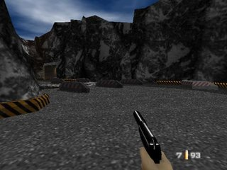
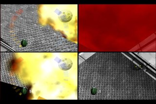
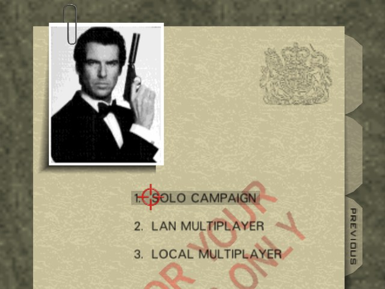
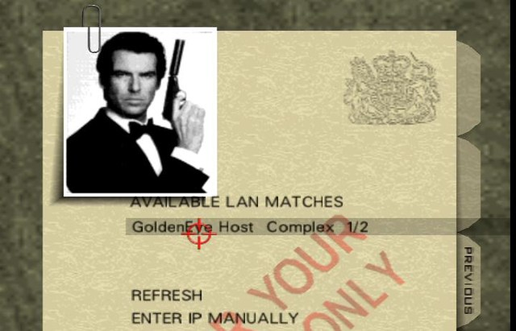
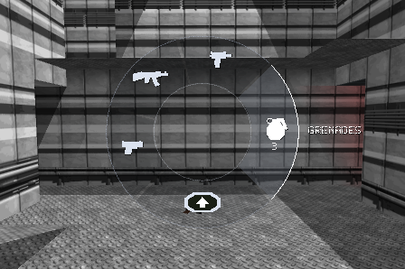
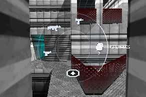
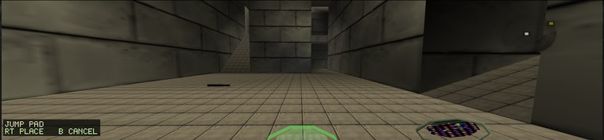
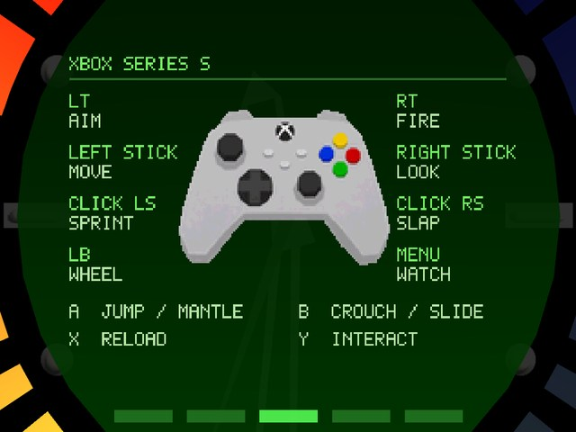
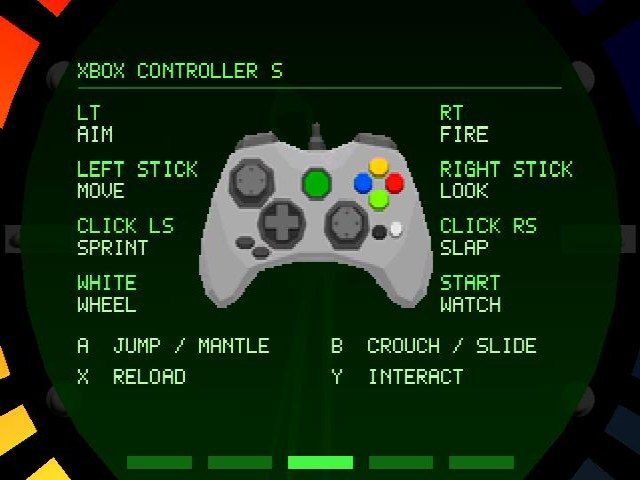

# GoldenEye 007 for Original Xbox and Windows

Play GoldenEye on an original Xbox or a Windows PC with modern twin-stick controls. Gather up to four players around one screen, or connect an Xbox and a PC for a one-on-one match on the same LAN. Either machine can host.

Our goals are easy couch play and private LAN cross-play, a shared modern control layout on Windows and Xbox, and smooth frame delivery on the original Xbox. We measure the frames the console actually displays, including the long frames you feel during a firefight.

*Complex over LAN. The original Xbox is hosting, and a Windows player has joined.*

| Solo Campaign · Dam | Local Multiplayer · Complex |
| --- | --- |
|  |  |
|  Xbox build running in xemu |  Four players on one original Xbox |

## Choose a game mode

|  Windows · Main dossier |  Original Xbox · Joining a LAN match |
| --- | --- |
|  |  |

For a two-player match, choose **LAN Multiplayer** on both machines. On one, choose **Host Match**. On the other, choose **Join Match** and select the host under **Available LAN Matches**. In the Xbox capture, **Complex 1/2** means one player is in the match and one slot is open. Choose **Refresh** if the host started after you opened the list.

| Windows and Xbox dossier option | How to play | Tested |
| --- | --- | --- |
| **Solo Campaign** | Choose a mission and difficulty from the dossier. | Dam, Jungle and Streets have reached first-person play on original Xbox. Full campaign progression on the console is still being verified. |
| **LAN Multiplayer** | Use matching builds on the same LAN. Pick **Host Match** on either machine. On the other, pick **Join Match** and select the host. **Enter IP manually** is also available. | Original Xbox and Windows have each hosted a two-player match in Complex. [Host discovery](https://github.com/ZacharyLeahan/goldeneye-nxdk/issues/23) · [Xbox hosting](https://github.com/ZacharyLeahan/goldeneye-nxdk/issues/24) |
| **Local Multiplayer** | Connect controllers, choose an arena and rules in Multiplayer Options, then press Start. | Windows and Xbox support 2–4 players on one screen. Four-player combat was tested in Complex on Windows and across all eleven arenas on original Xbox. |

**Try the bot prototype.** Connect two controllers, highlight **Local Multiplayer**, and press **D-pad right** to start Facility with one computer opponent. Both players keep their own half of the screen. Press **A** on the same row for the regular couch setup.

## Build and play from Windows

1. Download **[build.cmd](https://github.com/ZacharyLeahan/goldeneye-nxdk/releases/download/builder-1.0/build.cmd)** into its own folder on a 64-bit Windows PC. This small launcher is the release download.
2. Put your retail US GoldenEye 007 ROM beside it, either as a big-endian `.z64` file or a ZIP containing the `.z64`. You can also put it in a `rom` subfolder. The launcher checks the cartridge bytes against the supported US checksum.
3. Double-click **build.cmd**. Choose **Windows**, **Original Xbox**, or **Both**. On the first run, allow time and disk space for the matching game source, MSYS2 tools and, for Xbox, the nxdk toolchain. Review any installation prompts. Subsequent runs reuse the downloaded source and tools.

The launcher opens the finished folders after an interactive build.

| Build | What to do next |
| --- | --- |
|  **Windows** | Open `build-pc\play` and launch `ge007.x86_64.exe`. Keep its DLLs and `data` folder with it. |
|  **Original Xbox** | Copy all three files from `build-xbox\disc` into one game folder on your Xbox. Launch `default.xbe` from the dashboard. For xemu, load the locally generated `build-xbox\ge007.iso` in a 64 MiB Xbox profile. |

For command-line use, run `build.cmd windows`, `build.cmd xbox`, or `build.cmd both`. In a source checkout or extracted source archive the same script builds that copy. The standalone download fetches its tagged source into a folder beside the launcher. Keep the resulting game and cartridge files private. [Release notes](https://github.com/ZacharyLeahan/goldeneye-nxdk/releases/tag/builder-1.0) · [Manual Windows build](docs/building.md) · [Manual Xbox build](DOWNSTREAM.md#build-and-boot)

## Modern movement and equipment

The controls take inspiration from modern shooters like *THE FINALS*. Sprint into a slide, mantle a ledge, or use the equipment wheel to throw a grenade or deploy a jump pad.

|  Windows |  Original Xbox (xemu) |
| --- | --- |
|  |  |
| Hold **LB** to open the wheel. | Hold **White** to open the wheel. |

Both players are in Complex with the same pickups. Starting at the lower left and moving clockwise, the guns are the **PP7**, **KF7 Soviet**, and **ZMG**. **Grenades** sit on the right with the remaining count beneath them. The **jump pad** sits at the bottom. Point the right stick at a slot and release the wheel button to equip it.

 **Windows · Placing a jump pad**

Aim at level ground. When the preview turns green, press **RT** to place the pad.

## Controls

The Windows and original Xbox development builds show their own controller on the pause watch. The published **builder-1.0** uses the earlier watch artwork.

|  Windows · Xbox Series controller |  Original Xbox · Controller S |
| --- | --- |
|  |  |

| Action | Controller input |
| --- | --- |
| Move and look | Move with the **left stick** and look with the **right stick**. |
| Campaign watch | Press **Menu** on Windows or **Start** on original Xbox. |
| Jump and mantle | Press **A** to jump. Move toward a ledge and press **A** near the lip to climb it. |
| Crouch and slide | Tap **B** to crouch. Tap **B** while sprinting at speed to slide. Press **A** to jump out of the slide. |
| Quick slap | Click the **right stick** on Windows or Xbox to strike with Bond’s palm and return to your equipped weapon. |
| Sprint | Click the **left stick** while moving forward. |
| Aim and fire | Look with the **right stick**, hold **LT** for fine aim and pull **RT** to fire. **X** reloads and **Y** interacts. |
| Equipment wheel | Hold **LB** on Windows or **White** on Xbox. Point the right stick and release to equip. Right selects grenades, down selects the jump pad, and the other slots hold owned guns. Each player controls their own wheel. |
| Deploy a jump pad | Equip the pad, aim at a valid floor surface and pull **RT**. Either player can use the placed pad. |

In Windows and Xbox multiplayer, damaging an opposing player reveals their health above them, with a blue row for armor. Another hit refreshes the meter. It holds for 3.25 seconds and fades over 0.20 seconds.

## Performance on Windows and original Xbox

In a 24-second Jungle opening on original Xbox at 480p, campaign tuning raised displayed FPS from **35.22 to 40.81**. In two matched Streets combat tests, a later change reduced frames lasting over 40 ms from **12 to 3** across about 58 seconds per condition. Average FPS stayed close to 50. [Campaign test conditions and results](docs/dev/findings.md#d602--original-xbox-solo-streets-combat-frame-pacing)

**Original Xbox split-screen falls short of sustained 60 FPS during close-range grenade combat.** Each average below gives equal weight to all 11 arenas, using one 12-second replay per arena and player count. FPS counts distinct frames displayed on the console.

| Local players | Average displayed FPS | Range across arenas |
| --- | ---: | ---: |
| 2 | 48.8 | 42.9–50.7 |
| 3 | 38.3 | 27.8–45.1 |
| 4 | 22.3 | 18.7–25.7 |

Four-player combat was slowest on Egypt and fastest on Stack. Across the 11 four-player runs, the 95th-percentile frame interval ranged from 66.7 to 83.3 ms. A steady 60 FPS would display a new frame every 16.7 ms. [Per-arena results and test conditions](DOWNSTREAM.md#local-multiplayer-release-measurements)

| Platform and workload | Measured frame rate |
| --- | --- |
|  Windows, fixed Egypt camera, two game processes on one PC | **60.00 FPS host / 59.99 FPS guest**. Each rate uses the time between 1,437 consecutive render completions over about 24 seconds. |
|  Original Xbox, same Egypt LAN firefight, 480p | **50.00 → 59.13 displayed FPS** with the scheduler fix. Observed repeated refreshes fell from **113 to 8**. The 95th-percentile display interval fell from 33.33 to 16.67 ms. |
|  Original Xbox, heavy two-player Egypt split-screen | **46.29 displayed FPS** across 925 comparable camera steps with the regular vertex writer. Both players turned, fired and threw grenades. |
|  Original Xbox, four-player local combat on all 11 arenas | **34.07 completed FPS** over 322.79 seconds. The slowest arena was Caverns at 24.5 FPS overall and 17.0 FPS during the grenade window. [Per-arena frame times](DOWNSTREAM.md#four-player-frame-times-on-original-xbox) |

Completed FPS counts render completions. Displayed FPS counts distinct frames seen at physical Xbox refreshes. The LAN guest draws one full-screen view. Local split-screen draws each active player's view. To see displayed FPS and recent frame times during play, place an empty `ge-perf-hud.on` file beside the Xbox executable and relaunch. [Performance overlay](DOWNSTREAM.md#performance-overlay) · [Windows replay and measurement instructions](DOWNSTREAM.md) · [Xbox LAN measurements](https://github.com/ZacharyLeahan/goldeneye-nxdk/issues/21#issuecomment-7015760434) · [Xbox split-screen measurements](https://github.com/ZacharyLeahan/goldeneye-nxdk/issues/21#issuecomment-7016289480)

The largest LAN gain came from starting graphics work sooner. When an audio task and a graphics task arrived together, the earlier scheduler left both queued until the next refresh. Accepting the pair immediately and preserving audio priority cut average submission-to-handoff time from **4.05 to 0.66 ms**. The renderer also skips drawing the hidden LAN seat while continuing its gameplay updates. Reusing material setup across vertex loads saved another **0.14–0.18 ms per frame** in two separate hardware trials. [Scheduler trace](https://github.com/ZacharyLeahan/goldeneye-nxdk/issues/21#issuecomment-7015760434) · [Material reuse trials](https://github.com/ZacharyLeahan/goldeneye-nxdk/issues/21#issuecomment-7014737918)

Caching the equipment-wheel artwork helped local multiplayer most when both players opened it. The fixed Complex scene went from **7.5 to 60.0 FPS**. A separate experimental LAN renderer reached **59.92 displayed FPS** in Egypt, with zero observed repeats and one gap in refresh sampling. The playable build uses the scheduler fix. [Equipment-wheel measurements](DOWNSTREAM.md#original-xbox) · [Experimental renderer A/B](https://github.com/ZacharyLeahan/goldeneye-nxdk/issues/21#issuecomment-7016408401)

A physical Xbox joined a Windows host and fired on all eleven retail multiplayer arenas. The reverse direction was tested in Complex with Xbox hosting and Windows joining. [LAN arena tests](https://github.com/ZacharyLeahan/goldeneye-nxdk/issues/19) · [Xbox host tests](https://github.com/ZacharyLeahan/goldeneye-nxdk/issues/24)

## Upstream and credits

- The reconstructed game comes from the GoldenEye 007 decompilation by Larry Ficken (kholdfuzion) and contributors. The native PC port supplies the desktop runtime, controls, menus and split-screen support that this fork builds on. [GoldenEye decompilation](https://github.com/n64decomp/007) · [GoldenEye PC port](https://github.com/jkdansereau/goldeneye-pc-port)
- The XboxDev community’s nxdk supplies the original Xbox toolchain, runtime and pbkit graphics library. The Xbox NV2A renderer and presentation fixes were adapted from Perfect Dark X. The Perfect Dark PC port by Ryan Dwyer and contributors provided the software Fast3D renderer lineage and a reference for porting Rare’s engine. [nxdk](https://github.com/XboxDev/nxdk) · [Perfect Dark X](https://github.com/GTTeancum/Perfect-Dark-X) · [Perfect Dark PC port](https://github.com/perfect-dark-pc-port/perfect_dark) · [Third-party notices](NOTICE)
- The Neverball nxdk port provided a comparison for Xbox push-buffer sizing and VBlank presentation. [Neverball for Xbox](https://github.com/ZacharyLeahan/neverball-nxdk) · [nxdk-gles11](https://github.com/Ryzee119/nxdk-gles11)
- We tested the Xbox build in [xemu](https://github.com/xemu-project/xemu) with the 1 MiB [OXOS BIOS](https://github.com/kooscode/oxos), version [v0.4.14](https://github.com/kooscode/oxos/releases/tag/v0.4.14). This setup checks boot and frame identity. We measure display timing on the physical Xbox.
- Popnoodler’s [GE32 Windows release](https://popnoodler.itch.io/ge32) was the original target for this fork’s movement and equipment extension. [Original extension and test records](https://github.com/ZacharyLeahan/goldeneye-nxdk/tree/builder-1.0/mods/the-finals)

For the base port’s campaign, PC settings and release history, see the [upstream README](https://github.com/jkdansereau/goldeneye-pc-port#readme).

Shared multiplayer code lives in `port/lan/`, Xbox-specific integration in `port/xbox/`, and shared native controls in `port/controls/`. Both builds attach the multiplayer menu to a generated copy of the upstream front end. [Bringing upstream changes into the fork](DOWNSTREAM.md#bring-windows-upstream-changes-into-the-fork)

## Legal

This unofficial, noncommercial fan project requires a legally obtained retail US GoldenEye 007 ROM. Players generate the game assets locally. GoldenEye 007 and James Bond belong to their respective rights holders. Nintendo, Rare, Microsoft, Valve, MGM, Danjaq, EON Productions, Embark Studios and Nexon have no affiliation with this project. The MIT license covers original port work. Inherited game sources and third-party components have separate terms. [License](LICENSE) · [Third-party notices](NOTICE)
